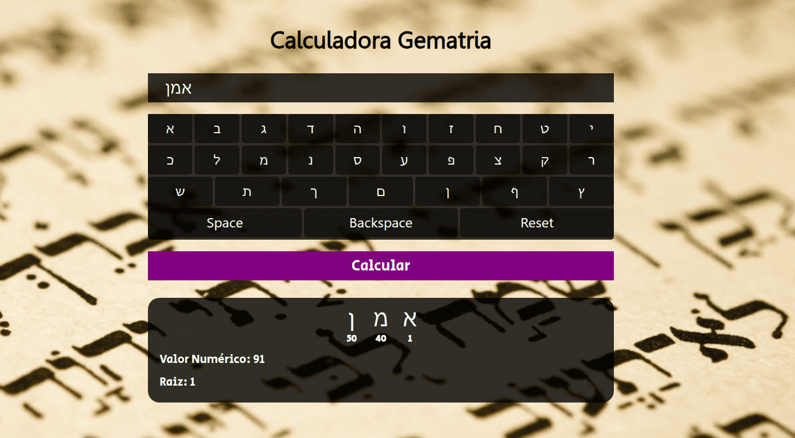

   

### Gematria
Calcula o valor numérico e a raiz das palavras hebraicas de acordo com a gematria, com teclado virtual em hebraico.

### Screenshot

### Demo
[https://titenq.github.io/gematria/](https://titenq.github.io/gematria "https://titenq.github.io/gematria")

### Stack
- HTML
- CSS
- JavaScript

## License
Distributed under `GPL-3.0`. See `LICENSE.txt`.

<!-- Stargazers generated automatically with npx @titenq/stargazers -->
## ⭐ Stargazers
This repository has no stargazers yet. Be the first!
